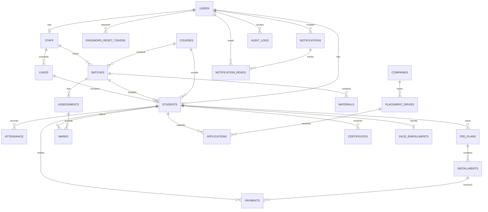

# Academy Management System ERD

`expenses` and `settings` are standalone operational tables. Foreign keys are
indexed where they are used for ownership, filtering, or joins. Student,
staff, lead, and course records use soft deletion; financial and attendance
history is retained.
